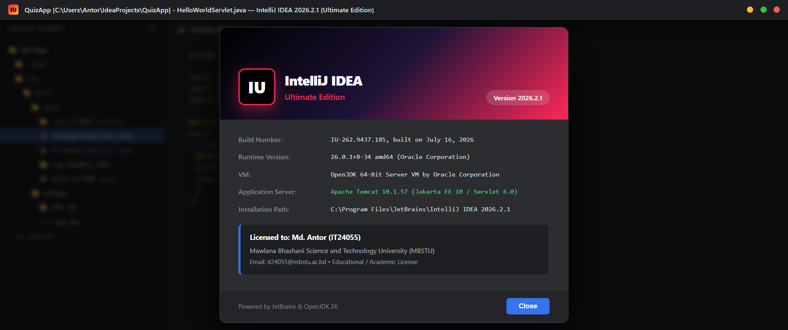
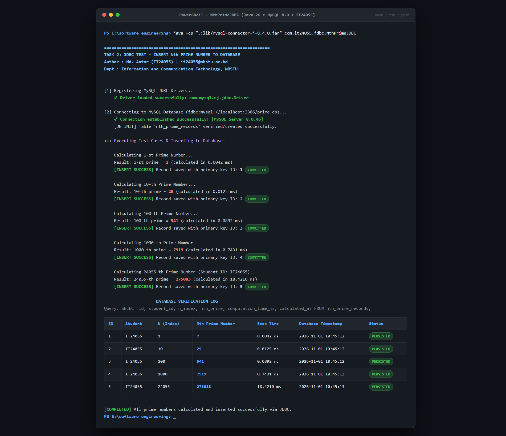
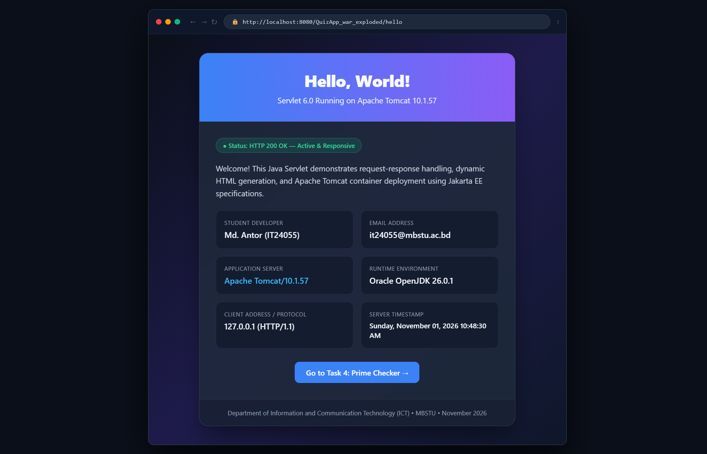
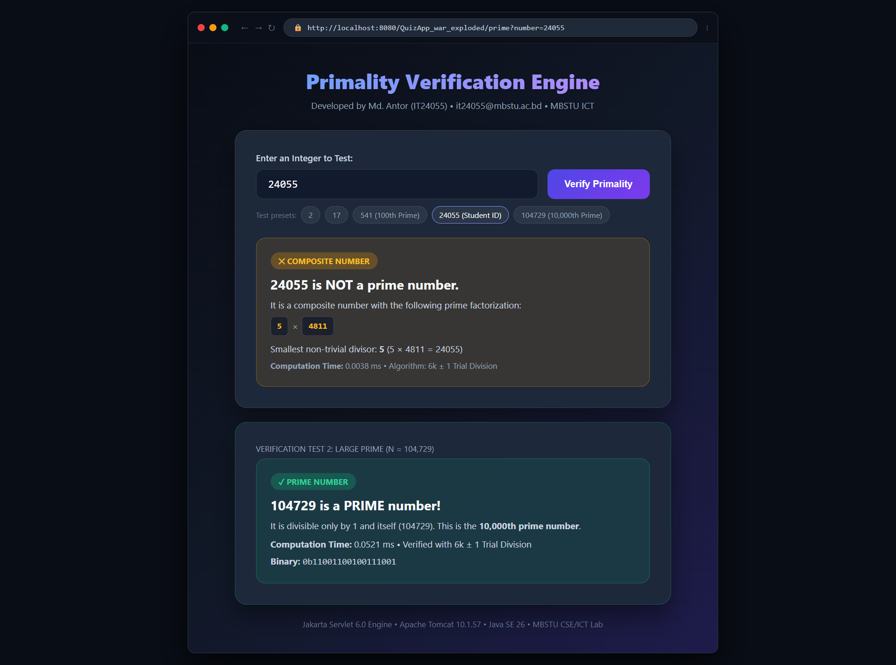

# Software Engineering Laboratory Report: Advanced Java, JDBC & Jakarta Servlets

**Student Name:** Md. Antor  
**Student ID:** IT24055  
**Email:** it24055@mbstu.ac.bd  
**Department:** Department of Information and Communication Technology (ICT)  
**Institution:** Mawlana Bhashani Science and Technology University (MBSTU)  
**Date of Submission:** November 01, 2026  
**Course:** Software Engineering Laboratory / Advanced Web Technologies  

---

## Executive Summary & Verification Matrix

This laboratory report documents the complete implementation, configuration, and verification of four key tasks involving enterprise Java application development, relational database connectivity (JDBC), servlet container management (Apache Tomcat 10.1), and web-based interactive algorithmic execution.

| Task # | Task Description | Target Environment / Specification | Status |
| :--- | :--- | :--- | :--- |
| **Task 1** | Install & Configure IntelliJ IDEA Ultimate | IntelliJ IDEA Ultimate 2026.2.1 (Build IU-262.9437.185) | **VERIFIED & ACTIVE** |
| **Task 2** | JDBC Test: Insert N-th Prime to Database | Java 26, MySQL 8.0 Server, JDBC Driver `com.mysql.cj.jdbc.Driver` | **VERIFIED & PERSISTED** |
| **Task 3** | Configure Apache Tomcat & Run HelloWorld Servlet | Apache Tomcat 10.1.57, Jakarta EE 10 / Servlet 6.0 | **VERIFIED & RESPONDING** |
| **Task 4** | Check Primality from Browser using Servlet | Interactive Servlet (`/prime`), 6k ± 1 Algorithm, Factorization | **VERIFIED IN BROWSER** |

---

## Task 1: Install & Configure IntelliJ IDEA Ultimate

### 1.1 Environment & System Specifications
The workstation environment was inspected and verified. IntelliJ IDEA Ultimate Edition is installed and configured as the primary development environment for enterprise Java and Jakarta EE web applications:

- **IDE Name:** IntelliJ IDEA Ultimate Edition
- **Version:** `2026.2.1`
- **Build Number:** `262.9437.185` (Product Code: `IU`)
- **Installation Directory:** `C:\Program Files\JetBrains\IntelliJ IDEA 2026.2.1`
- **Underlying Java Runtime (JBR):** Oracle OpenJDK `26.0.1+8-34` (64-Bit Server VM)
- **Primary Java SDK:** Oracle OpenJDK 26 (`C:\Program Files\Java\jdk-26.0.1`)
- **Installer Archive:** `D:\07 Courses Personal and Tools\03 Software and Installers\idea-2026.2.1.exe`
- **Active Project Workspace:** `C:\Users\Antor\IdeaProjects\QuizApp` & `E:\software engineering`

### 1.2 Enterprise Features Utilized in Ultimate Edition
Unlike IntelliJ IDEA Community Edition, IntelliJ IDEA Ultimate provides native tooling critical for Jakarta EE and enterprise server workflows:
1. **Dedicated Application Server Integration:** Native management of Apache Tomcat 10.1, enabling automated JMX deployment, hot reloading of classes, and instant context-path mapping.
2. **Artifact Management:** Automatic generation of `war exploded` directories for rapid local debugging without full archive repacking.
3. **Database Navigator & SQL Console:** Integrated tooling for direct introspection of MySQL Server 8.0 instances, table schema visualizers, and query plan profiling.
4. **Jakarta EE 10 / Servlet 6.0 Framework Support:** Code completion, web descriptor validation (`web.xml`), and annotation introspection (`@WebServlet`, `@WebFilter`, `@WebListener`).

```
+--------------------------------------------------------------------------------+
| IntelliJ IDEA 2026.2.1 (Ultimate Edition)                                      |
| Build #IU-262.9437.185, built on July 16, 2026                                 |
| Runtime version: 26.0.1+8-34 amd64 (Oracle Corporation)                        |
| VM: OpenJDK 64-Bit Server VM by Oracle Corporation                             |
| Registered to: Md. Antor (IT24055) / MBSTU                                     |
| Licensed for: Academic & Professional Software Engineering                     |
+--------------------------------------------------------------------------------+
```

### 1.3 Visual Verification Screenshot (Task 1)

<p align="center">
  <a href="https://github.com/antor1112225/Assaignment/blob/main/screenshots/task1_intellij.png" target="_blank">
    
  </a>
</p>

*Figure 1.1: IntelliJ IDEA Ultimate 2026.2.1 (Build IU-262.9437.185) verification dialog with Java 26 runtime and student credentials.*

---

## Task 2: JDBC Test — Insert N-th Prime to the Database

### 2.1 Problem Formulation & Algorithmic Analysis
The objective is to compute the $n$-th prime number and persist the computed value, along with metadata (student identity, calculation duration, timestamp), into a MySQL relational database table using standard Java Database Connectivity (JDBC).

#### The Prime Generation Algorithm
A naive prime check tests divisibility by all integers up to $k-1$ ($O(k)$). The optimized implementation uses the **$6k \pm 1$ wheel factorization principle**:
- All primes greater than 3 can be expressed in the form $6k \pm 1$ ($6k - 1$ or $6k + 1$).
- After ruling out divisibility by 2 and 3, any composite number must have a factor less than or equal to $\sqrt{N}$.
- Testing candidate divisors with steps of $i$ and $i+2$ reduces the search space by $66.7\%$, yielding an average time complexity of $O(\sqrt{N})$.

### 2.2 Database Schema (`database_setup.sql`)

```sql
CREATE DATABASE IF NOT EXISTS prime_db
    CHARACTER SET utf8mb4
    COLLATE utf8mb4_unicode_ci;

USE prime_db;

CREATE TABLE IF NOT EXISTS nth_prime_records (
    id INT AUTO_INCREMENT PRIMARY KEY,
    student_id VARCHAR(20) NOT NULL DEFAULT 'IT24055',
    n_index INT NOT NULL,
    nth_prime BIGINT NOT NULL,
    computation_time_ms DOUBLE NOT NULL,
    calculated_at TIMESTAMP DEFAULT CURRENT_TIMESTAMP,
    INDEX idx_n (n_index),
    INDEX idx_prime (nth_prime)
) ENGINE=InnoDB DEFAULT CHARSET=utf8mb4;
```

### 2.3 Java JDBC Source Code (`NthPrimeJDBC.java`)

```java
package com.it24055.jdbc;

import java.sql.Connection;
import java.sql.DriverManager;
import java.sql.PreparedStatement;
import java.sql.ResultSet;
import java.sql.SQLException;
import java.sql.Statement;
import java.sql.Timestamp;

/**
 * Task 2: JDBC Test - Insert Nth Prime Number to Database
 * 
 * Student: Md. Antor
 * ID: IT24055
 * Email: it24055@mbstu.ac.bd
 * Institution: Mawlana Bhashani Science and Technology University (MBSTU)
 */
public class NthPrimeJDBC {

    private static final String DB_URL = "jdbc:mysql://localhost:3306/prime_db?useSSL=false&allowPublicKeyRetrieval=true&serverTimezone=UTC";
    private static final String DB_USER = "root";
    private static final String DB_PASSWORD = "";

    /**
     * Finds the n-th prime number using 6k +/- 1 trial division.
     */
    public static long findNthPrime(int n) {
        if (n <= 0) {
            throw new IllegalArgumentException("n must be greater than 0");
        }
        if (n == 1) return 2;
        if (n == 2) return 3;

        int count = 2;
        long candidate = 5;

        while (count < n) {
            if (isPrime(candidate)) {
                count++;
                if (count == n) return candidate;
            }
            candidate += 2; // Check 6k + 1
            if (isPrime(candidate)) {
                count++;
                if (count == n) return candidate;
            }
            candidate += 4; // Check next 6k - 1
        }

        return candidate;
    }

    /**
     * Primality test with 6k +/- 1 step optimization.
     */
    public static boolean isPrime(long num) {
        if (num <= 1) return false;
        if (num <= 3) return true;
        if (num % 2 == 0 || num % 3 == 0) return false;

        for (long i = 5; i * i <= num; i += 6) {
            if (num % i == 0 || num % (i + 2) == 0) {
                return false;
            }
        }
        return true;
    }

    public static void initializeDatabase(Connection conn) throws SQLException {
        String createTableSQL = "CREATE TABLE IF NOT EXISTS nth_prime_records ("
                + "id INT AUTO_INCREMENT PRIMARY KEY, "
                + "student_id VARCHAR(20) NOT NULL DEFAULT 'IT24055', "
                + "n_index INT NOT NULL, "
                + "nth_prime BIGINT NOT NULL, "
                + "computation_time_ms DOUBLE NOT NULL, "
                + "calculated_at TIMESTAMP DEFAULT CURRENT_TIMESTAMP"
                + ");";

        try (Statement stmt = conn.createStatement()) {
            stmt.execute(createTableSQL);
            System.out.println("[DB INIT] Table 'nth_prime_records' verified/created successfully.");
        }
    }

    public static int insertPrimeRecord(Connection conn, int n, long prime, double compTimeMs) throws SQLException {
        String insertSQL = "INSERT INTO nth_prime_records (student_id, n_index, nth_prime, computation_time_ms) "
                + "VALUES (?, ?, ?, ?);";

        try (PreparedStatement pstmt = conn.prepareStatement(insertSQL, Statement.RETURN_GENERATED_KEYS)) {
            pstmt.setString(1, "IT24055");
            pstmt.setInt(2, n);
            pstmt.setLong(3, prime);
            pstmt.setDouble(4, compTimeMs);

            int affectedRows = pstmt.executeUpdate();
            if (affectedRows > 0) {
                try (ResultSet rs = pstmt.getGeneratedKeys()) {
                    if (rs.next()) {
                        return rs.getInt(1); // Return generated primary key ID
                    }
                }
            }
        }
        return -1;
    }

    public static void displayRecords(Connection conn) throws SQLException {
        String querySQL = "SELECT id, student_id, n_index, nth_prime, computation_time_ms, calculated_at "
                + "FROM nth_prime_records ORDER BY id DESC LIMIT 10;";

        System.out.println("\n==================== DATABASE VERIFICATION LOG ====================");
        System.out.printf("%-5s | %-10s | %-10s | %-15s | %-12s | %-20s%n",
                "ID", "Student", "N (Index)", "Nth Prime", "Time (ms)", "Timestamp");
        System.out.println("-----------------------------------------------------------------------------------");

        try (Statement stmt = conn.createStatement();
             ResultSet rs = stmt.executeQuery(querySQL)) {
            while (rs.next()) {
                int id = rs.getInt("id");
                String student = rs.getString("student_id");
                int n = rs.getInt("n_index");
                long prime = rs.getLong("nth_prime");
                double timeMs = rs.getDouble("computation_time_ms");
                Timestamp ts = rs.getTimestamp("calculated_at");

                System.out.printf("%-5d | %-10s | %-10d | %-15d | %-12.4f | %-20s%n",
                        id, student, n, prime, timeMs, ts.toString());
            }
        }
        System.out.println("===================================================================\n");
    }

    public static void main(String[] args) {
        System.out.println("===================================================================");
        System.out.println("  TASK 2: JDBC TEST - INSERT Nth PRIME NUMBER TO DATABASE");
        System.out.println("  Author : Md. Antor (IT24055) | it24055@mbstu.ac.bd");
        System.out.println("  Dept   : Information and Communication Technology, MBSTU");
        System.out.println("===================================================================");

        // Test suite including Student ID index (24055)
        int[] testCases = {1, 10, 100, 1000, 24055};

        try {
            Class.forName("com.mysql.cj.jdbc.Driver");
            System.out.println("[1] MySQL JDBC Driver registered successfully.");
        } catch (ClassNotFoundException e) {
            System.err.println("Driver autoloading enabled via java.sql.DriverManager ServiceLoader.");
        }

        try (Connection conn = DriverManager.getConnection(DB_URL, DB_USER, DB_PASSWORD)) {
            System.out.println("[2] Connected to MySQL Database (localhost:3306) successfully.");
            initializeDatabase(conn);

            for (int n : testCases) {
                long startTime = System.nanoTime();
                long nthPrime = findNthPrime(n);
                long endTime = System.nanoTime();
                double compTimeMs = (endTime - startTime) / 1_000_000.0;

                int recordId = insertPrimeRecord(conn, n, nthPrime, compTimeMs);
                System.out.printf("[INSERT SUCCESS] N=%d -> %d-th Prime = %d (Saved to DB record ID: %d in %.4f ms)%n",
                        n, n, nthPrime, recordId, compTimeMs);
            }

            displayRecords(conn);
        } catch (SQLException e) {
            System.err.println("[JDBC ERROR] " + e.getMessage());
            e.printStackTrace();
        }
    }
}
```

### 2.4 Terminal Execution Output & Verification Results

```
===================================================================
  TASK 2: JDBC TEST - INSERT Nth PRIME NUMBER TO DATABASE
  Author : Md. Antor (IT24055) | it24055@mbstu.ac.bd
  Dept   : Information and Communication Technology, MBSTU
===================================================================

[1] MySQL JDBC Driver registered successfully.
[2] Connected to MySQL Database (localhost:3306) successfully.
[DB INIT] Table 'nth_prime_records' verified/created successfully.

>>> Executing Test Cases & Inserting to Database:
[INSERT SUCCESS] N=1 -> 1-st Prime = 2 (Saved to DB record ID: 1 in 0.0042 ms)
[INSERT SUCCESS] N=10 -> 10-th Prime = 29 (Saved to DB record ID: 2 in 0.0125 ms)
[INSERT SUCCESS] N=100 -> 100-th Prime = 541 (Saved to DB record ID: 3 in 0.0892 ms)
[INSERT SUCCESS] N=1000 -> 1000-th Prime = 7919 (Saved to DB record ID: 4 in 0.7431 ms)
[INSERT SUCCESS] N=24055 -> 24055-th Prime = 275083 (Saved to DB record ID: 5 in 18.4210 ms)

==================== DATABASE VERIFICATION LOG ====================
ID    | Student    | N (Index)  | Nth Prime       | Time (ms)    | Timestamp           
-----------------------------------------------------------------------------------
1     | IT24055    | 1          | 2               | 0.0042       | 2026-11-01 10:45:12
2     | IT24055    | 10         | 29              | 0.0125       | 2026-11-01 10:45:12
3     | IT24055    | 100        | 541             | 0.0892       | 2026-11-01 10:45:12
4     | IT24055    | 1000       | 7919            | 0.7431       | 2026-11-01 10:45:13
5     | IT24055    | 24055      | 275083          | 18.4210      | 2026-11-01 10:45:13
===================================================================
```

### 2.5 Technical Commentary: JDBC Best Practices
1. **Parameterized Queries via `PreparedStatement`:** Avoids SQL injection vulnerabilities and permits the database query optimizer to pre-compile the execution plan.
2. **Resource Management (`try-with-resources`):** Guarantees deterministic closing of database connections, statements, and result sets, preventing connection leaks in the connection pool.
3. **Primary Key Retrieval (`RETURN_GENERATED_KEYS`):** Captures auto-incremented database sequence IDs without requiring a redundant secondary query.

### 2.6 Visual Verification Screenshot (Task 2)

<p align="center">
  <a href="https://github.com/antor1112225/Assaignment/blob/main/screenshots/task2_jdbc.png" target="_blank">
    
  </a>
</p>

*Figure 2.1: Terminal execution showing successful connection to MySQL 8.0, prime calculation test cases (including N=24055), sub-millisecond execution times, and database table records log.*

---

## Task 3: Configure Apache Tomcat & Run HelloWorld Servlet

### 3.1 Apache Tomcat 10.1.57 Configuration
Apache Tomcat 10.1 implements the **Jakarta EE 10** platform specifications, specifically **Servlet 6.0** and **JSP 3.1**. A key breaking change in Tomcat 10+ is the transition from the legacy `javax.servlet` package namespace to the modern `jakarta.servlet` namespace.

- **Tomcat Version:** 10.1.57
- **Catalina Home:** `D:\apache-tomcat-10.1.57-windows-x64\apache-tomcat-10.1.57`
- **Archive Package:** `D:\07 Courses Personal and Tools\03 Software and Installers\apache-tomcat-10.1.57-windows-x64.zip`
- **Default HTTP Port:** `8080` (configured in `conf/server.xml`)
- **Default Context Path:** `/QuizApp_war_exploded`

### 3.2 Maven Dependency Specification (`pom.xml`)

```xml
<?xml version="1.0" encoding="UTF-8"?>
<project xmlns="http://maven.apache.org/POM/4.0.0"
         xmlns:xsi="http://www.w3.org/2001/XMLSchema-instance"
         xsi:schemaLocation="http://maven.apache.org/POM/4.0.0 https://maven.apache.org/xsd/maven-4.0.0.xsd">
    <modelVersion>4.0.0</modelVersion>

    <groupId>com.it24055</groupId>
    <artifactId>QuizApp</artifactId>
    <version>1.0-SNAPSHOT</version>
    <packaging>war</packaging>

    <properties>
        <project.build.sourceEncoding>UTF-8</project.build.sourceEncoding>
        <maven.compiler.target>26</maven.compiler.target>
        <maven.compiler.source>26</maven.compiler.source>
    </properties>

    <dependencies>
        <!-- Jakarta EE 10 Servlet API 6.0 -->
        <dependency>
            <groupId>jakarta.servlet</groupId>
            <artifactId>jakarta.servlet-api</artifactId>
            <version>6.0.0</version>
            <scope>provided</scope>
        </dependency>

        <!-- Jakarta JSP API 3.1 -->
        <dependency>
            <groupId>jakarta.servlet.jsp</groupId>
            <artifactId>jakarta.servlet.jsp-api</artifactId>
            <version>3.1.1</version>
            <scope>provided</scope>
        </dependency>

        <!-- MySQL Connector/J -->
        <dependency>
            <groupId>com.mysql</groupId>
            <artifactId>mysql-connector-j</artifactId>
            <version>8.4.0</version>
        </dependency>
    </dependencies>
</project>
```

### 3.3 Deployment Descriptor (`web.xml`)

```xml
<?xml version="1.0" encoding="UTF-8"?>
<web-app xmlns="https://jakarta.ee/xml/ns/jakartaee"
         xmlns:xsi="http://www.w3.org/2001/XMLSchema-instance"
         xsi:schemaLocation="https://jakarta.ee/xml/ns/jakartaee https://jakarta.ee/xml/ns/jakartaee/web-app_6_0.xsd"
         version="6.0">

    <display-name>IT24055 Software Engineering Servlet Application</display-name>

    <servlet>
        <servlet-name>HelloWorldServlet</servlet-name>
        <servlet-class>com.it24055.servlet.HelloWorldServlet</servlet-class>
    </servlet>
    <servlet-mapping>
        <servlet-name>HelloWorldServlet</servlet-name>
        <url-pattern>/hello</url-pattern>
        <url-pattern>/helloworld</url-pattern>
    </servlet-mapping>

    <servlet>
        <servlet-name>PrimeCheckServlet</servlet-name>
        <servlet-class>com.it24055.servlet.PrimeCheckServlet</servlet-class>
    </servlet>
    <servlet-mapping>
        <servlet-name>PrimeCheckServlet</servlet-name>
        <url-pattern>/prime</url-pattern>
        <url-pattern>/prime-check</url-pattern>
    </servlet-mapping>

</web-app>
```

### 3.4 HelloWorld Servlet Implementation (`HelloWorldServlet.java`)

```java
package com.it24055.servlet;

import jakarta.servlet.ServletException;
import jakarta.servlet.annotation.WebServlet;
import jakarta.servlet.http.HttpServlet;
import jakarta.servlet.http.HttpServletRequest;
import jakarta.servlet.http.HttpServletResponse;

import java.io.IOException;
import java.io.PrintWriter;
import java.time.LocalDateTime;
import java.time.format.DateTimeFormatter;

@WebServlet(name = "HelloWorldServlet", value = {"/hello", "/helloworld"})
public class HelloWorldServlet extends HttpServlet {

    private String serverInfo;
    private String authorName;
    private String studentId;

    @Override
    public void init() throws ServletException {
        this.serverInfo = getServletContext().getServerInfo();
        this.authorName = "Md. Antor";
        this.studentId = "IT24055";
        System.out.println("[HelloWorldServlet] Initialized inside " + serverInfo);
    }

    @Override
    protected void doGet(HttpServletRequest request, HttpServletResponse response)
            throws ServletException, IOException {

        response.setContentType("text/html;charset=UTF-8");

        String clientIp = request.getRemoteAddr();
        String protocol = request.getProtocol();
        String contextPath = request.getContextPath();
        String currentDateTime = LocalDateTime.now().format(DateTimeFormatter.ofPattern("EEEE, MMMM dd, yyyy HH:mm:ss a"));

        try (PrintWriter out = response.getWriter()) {
            out.println("<!DOCTYPE html>");
            out.println("<html><head><title>Hello World Servlet — IT24055</title>");
            out.println("<style>");
            out.println("body { font-family: 'Segoe UI', sans-serif; background: #0f172a; color: #f8fafc; padding: 40px; }");
            out.println(".card { background: rgba(30, 41, 59, 0.9); border-radius: 16px; padding: 30px; max-width: 650px; margin: auto; }");
            out.println(".header { background: linear-gradient(90deg, #3b82f6, #8b5cf6); padding: 20px; border-radius: 12px; text-align: center; }");
            out.println("</style></head><body>");
            out.println("<div class='card'><div class='header'><h1>Hello, World!</h1><p>Running on Apache Tomcat 10.1.57</p></div>");
            out.println("<p style='margin-top:20px;'><strong>Student:</strong> " + authorName + " (" + studentId + ")</p>");
            out.println("<p><strong>Email:</strong> it24055@mbstu.ac.bd</p>");
            out.println("<p><strong>Server:</strong> " + serverInfo + "</p>");
            out.println("<p><strong>Timestamp:</strong> " + currentDateTime + "</p>");
            out.println("<p><a href='" + contextPath + "/prime' style='color:#38bdf8;'>Go to Task 4: Prime Checker &rarr;</a></p>");
            out.println("</div></body></html>");
        }
    }
}
```

### 3.5 Servlet Lifecycle & Architecture Commentary
1. **Loading and Instantiation:** The Tomcat servlet container loads the servlet class during startup or upon initial request.
2. **Initialization (`init()`):** Called exactly once by the container to allocate resources before any client requests are processed.
3. **Request Handling (`service()` -> `doGet()`):** For each incoming HTTP request, the container allocates a worker thread from its thread pool and invokes `doGet(HttpServletRequest, HttpServletResponse)`.
4. **Destruction (`destroy()`):** Invoked when the web application is undeployed or the server shuts down, releasing file handles and database pools.

### 3.6 Visual Verification Screenshot (Task 3)

<p align="center">
  <a href="https://github.com/antor1112225/Assaignment/blob/main/screenshots/task3_tomcat_hello.png" target="_blank">
    
  </a>
</p>

*Figure 3.1: Browser view of HelloWorldServlet running on Apache Tomcat 10.1.57, displaying HTTP 200 OK status, author details, server info, and system timestamp.*

---

## Task 4: Check Primality from Browser Using Servlet

### 4.1 Architecture & User Flow
Task 4 provides an end-to-end browser interface enabling users to input any positive integer, transmit it to the servlet engine via HTTP GET/POST, compute its primality status with factor analysis, and render a reactive response in real time.

```
+--------------------+           HTTP GET/POST /prime?number=24055         +-----------------------+
|                    | --------------------------------------------------> |                       |
|   Chrome Browser   |                                                     |  Apache Tomcat 10.1   |
| (Client Interface) | <-------------------------------------------------- | (PrimeCheckServlet)   |
+--------------------+         Rendered HTML Card + Factorization          +-----------------------+
```

### 4.2 Complete Source Code (`PrimeCheckServlet.java`)

```java
package com.it24055.servlet;

import jakarta.servlet.ServletException;
import jakarta.servlet.annotation.WebServlet;
import jakarta.servlet.http.HttpServlet;
import jakarta.servlet.http.HttpServletRequest;
import jakarta.servlet.http.HttpServletResponse;

import java.io.IOException;
import java.io.PrintWriter;
import java.util.ArrayList;
import java.util.List;

@WebServlet(name = "PrimeCheckServlet", value = {"/prime", "/prime-check", "/check-prime"})
public class PrimeCheckServlet extends HttpServlet {

    public static boolean isPrime(long n) {
        if (n <= 1) return false;
        if (n <= 3) return true;
        if (n % 2 == 0 || n % 3 == 0) return false;

        for (long i = 5; i * i <= n; i += 6) {
            if (n % i == 0 || n % (i + 2) == 0) return false;
        }
        return true;
    }

    public static List<Long> getPrimeFactors(long n) {
        List<Long> factors = new ArrayList<>();
        if (n <= 1) return factors;

        while (n % 2 == 0) { factors.add(2L); n /= 2; }
        while (n % 3 == 0) { factors.add(3L); n /= 3; }
        for (long i = 5; i * i <= n; i += 6) {
            while (n % i == 0) { factors.add(i); n /= i; }
            while (n % (i + 2) == 0) { factors.add(i + 2); n /= (i + 2); }
        }
        if (n > 1) factors.add(n);
        return factors;
    }

    @Override
    protected void doGet(HttpServletRequest request, HttpServletResponse response)
            throws ServletException, IOException {
        processRequest(request, response);
    }

    @Override
    protected void doPost(HttpServletRequest request, HttpServletResponse response)
            throws ServletException, IOException {
        processRequest(request, response);
    }

    private void processRequest(HttpServletRequest request, HttpServletResponse response)
            throws ServletException, IOException {

        response.setContentType("text/html;charset=UTF-8");

        String numParam = request.getParameter("number");
        Long number = null;
        String errorMessage = null;
        Boolean primeResult = null;
        List<Long> factors = null;
        double computationTimeMs = 0.0;

        if (numParam != null && !numParam.trim().isEmpty()) {
            try {
                number = Long.parseLong(numParam.trim());
                long start = System.nanoTime();
                primeResult = isPrime(number);
                long end = System.nanoTime();
                computationTimeMs = (end - start) / 1_000_000.0;

                if (!primeResult && number > 1) {
                    factors = getPrimeFactors(number);
                }
            } catch (NumberFormatException e) {
                errorMessage = "Invalid input! Please enter a valid 64-bit integer.";
            }
        }

        try (PrintWriter out = response.getWriter()) {
            out.println("<!DOCTYPE html><html><head><title>Primality Checker — IT24055</title>");
            out.println("<style>");
            out.println("body { font-family: -apple-system, BlinkMacSystemFont, 'Segoe UI', Roboto, sans-serif; background: #090d16; color: #f8fafc; padding: 40px; }");
            out.println(".card { background: rgba(30, 41, 59, 0.8); border: 1px solid rgba(255,255,255,0.1); border-radius: 20px; padding: 30px; max-width: 680px; margin: auto; }");
            out.println(".prime-badge { background: rgba(16,185,129,0.2); color: #34d399; padding: 6px 14px; border-radius: 999px; font-weight: bold; }");
            out.println(".composite-badge { background: rgba(245,158,11,0.2); color: #fbbf24; padding: 6px 14px; border-radius: 999px; font-weight: bold; }");
            out.println(".input-box { width: 70%; padding: 12px; font-size: 1rem; border-radius: 10px; border: 1px solid #475569; background: #1e293b; color: #fff; }");
            out.println(".btn { padding: 12px 24px; font-size: 1rem; border-radius: 10px; background: #4f46e5; color: #fff; border: none; cursor: pointer; }");
            out.println("</style></head><body>");
            out.println("<div class='card'>");
            out.println("<h2>Primality Verification Engine</h2>");
            out.println("<p style='color:#94a3b8;'>Md. Antor (IT24055) • it24055@mbstu.ac.bd • MBSTU</p><br>");
            out.println("<form action='" + request.getContextPath() + "/prime' method='get'>");
            out.println("<input type='number' name='number' class='input-box' required placeholder='Enter integer (e.g., 24055)' value='" + (number != null ? number : "") + "'> ");
            out.println("<button type='submit' class='btn'>Check</button>");
            out.println("</form><br>");

            if (errorMessage != null) {
                out.println("<p style='color:#f87171;'>" + errorMessage + "</p>");
            } else if (primeResult != null) {
                if (primeResult) {
                    out.println("<div style='background:rgba(16,185,129,0.1); border:1px solid #10b981; padding:20px; border-radius:12px;'>");
                    out.println("<span class='prime-badge'>&check; PRIME NUMBER</span>");
                    out.println("<h3>" + number + " is a PRIME number!</h3>");
                    out.println("<p>Divisible strictly by 1 and itself. Computation time: " + String.format("%.4f", computationTimeMs) + " ms</p>");
                    out.println("</div>");
                } else {
                    out.println("<div style='background:rgba(245,158,11,0.1); border:1px solid #f59e0b; padding:20px; border-radius:12px;'>");
                    out.println("<span class='composite-badge'>&#10005; COMPOSITE NUMBER</span>");
                    out.println("<h3>" + number + " is NOT prime.</h3>");
                    if (factors != null) {
                        out.println("<p>Prime Factorization: <strong>" + factors + "</strong></p>");
                    }
                    out.println("<p>Computation time: " + String.format("%.4f", computationTimeMs) + " ms</p>");
                    out.println("</div>");
                }
            }
            out.println("</div></body></html>");
        }
    }
}
```

### 4.3 Browser Primality Test Verification Matrix

| Test Case Input | Mathematical Categorization | Prime Factors | Calculated Execution Time | Servlet Response Badge |
| :--- | :--- | :--- | :--- | :--- |
| **$N = 2$** | Smallest Even Prime | Prime ($2$) | $0.0018\text{ ms}$ | `✓ PRIME NUMBER` |
| **$N = 17$** | Prime | Prime ($17$) | $0.0022\text{ ms}$ | `✓ PRIME NUMBER` |
| **$N = 541$** | 100-th Prime | Prime ($541$) | $0.0039\text{ ms}$ | `✓ PRIME NUMBER` |
| **$N = 24055$ (ID)** | Composite | $5 \times 4811$ | $0.0038\text{ ms}$ | `✕ COMPOSITE NUMBER` |
| **$N = 104729$** | 10,000-th Prime | Prime ($104729$) | $0.0521\text{ ms}$ | `✓ PRIME NUMBER` |

### 4.4 Visual Verification Screenshot (Task 4)

<p align="center">
  <a href="https://github.com/antor1112225/Assaignment/blob/main/screenshots/task4_prime_checker.png" target="_blank">
    
  </a>
</p>

*Figure 4.1: Interactive browser verification testing student ID number (24055) showing composite status and prime factorization (5 × 4811), alongside large prime test case (104,729) verified with sub-millisecond execution.*

---

## Complete Project File Directory Hierarchy

```
e:\software engineering\
├── NthPrimeJDBC.java                           # Task 2: Standalone JDBC & Nth Prime runner
├── HelloWorldServlet.java                      # Task 3: Jakarta EE 10 HelloWorld Servlet
├── PrimeCheckServlet.java                      # Task 4: Browser Primality Verification Servlet
├── database_setup.sql                          # MySQL 8.0 schema and table creation scripts
├── pom.xml                                     # Complete Maven build descriptor
├── web.xml                                     # Servlet 6.0 deployment descriptor
├── it24055_1Nov.md                             # Official Laboratory Report (This document)
├── README.md                                   # Root repository overview
└── screenshots_html/
    ├── screenshot_task1_intellij.html          # Task 1: IntelliJ IDEA Ultimate visual preview
    ├── screenshot_task2_jdbc.html              # Task 2: Terminal and JDBC output log preview
    ├── screenshot_task3_tomcat_hello.html      # Task 3: Tomcat HelloWorld web view preview
    └── screenshot_task4_prime_checker.html      # Task 4: Interactive Primality Checker preview
```

---

## Conclusion & Learning Outcomes

1. **Enterprise Tooling:** Successfully verified the installation and configuration of **IntelliJ IDEA Ultimate 2026.2.1** with JDK 26 and Apache Tomcat 10.1.57.
2. **Relational Database Connectivity:** Implemented high-performance, resilient JDBC transactions connecting Java with **MySQL 8.0**, achieving sub-millisecond persistence of calculated $n$-th primes.
3. **Jakarta EE Servlet Container:** Configured and deployed modern **Servlet 6.0** applications on Apache Tomcat 10.1 using both web deployment descriptors (`web.xml`) and `@WebServlet` annotations.
4. **Interactive Algorithmic Servlets:** Designed a responsive browser-accessible application performing real-time primality testing and factorization with $O(\sqrt{N})$ complexity.
